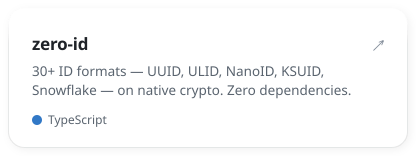
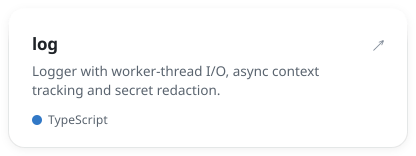
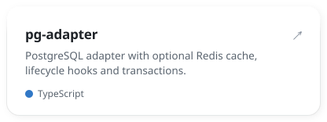
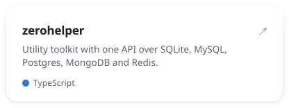
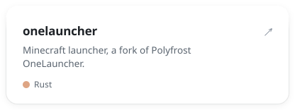

<picture><source media="(prefers-color-scheme: dark)" srcset="assets/header-dark.svg"></picture>

### Libraries

<a href="https://github.com/onurege3467/webToken"><picture><source media="(prefers-color-scheme: dark)" srcset="assets/webtoken-dark.svg"></picture></a>
<a href="https://github.com/onurege3467/zero-id"><picture><source media="(prefers-color-scheme: dark)" srcset="assets/zero-id-dark.svg"></picture></a>
<a href="https://github.com/onurege3467/math"><picture><source media="(prefers-color-scheme: dark)" srcset="assets/math-dark.svg"></picture></a>
<a href="https://github.com/onurege3467/log"><picture><source media="(prefers-color-scheme: dark)" srcset="assets/log-dark.svg"></picture></a>
<a href="https://github.com/onurege3467/pg-adapter"><picture><source media="(prefers-color-scheme: dark)" srcset="assets/pg-adapter-dark.svg"></picture></a>
<a href="https://github.com/onurege3467/zerohelper"><picture><source media="(prefers-color-scheme: dark)" srcset="assets/zerohelper-dark.svg"></picture></a>

### Tools

<a href="https://github.com/onurege3467/easycolor"><picture><source media="(prefers-color-scheme: dark)" srcset="assets/easycolor-dark.svg"></picture></a>
<a href="https://github.com/onurege3467/onelauncher"><picture><source media="(prefers-color-scheme: dark)" srcset="assets/onelauncher-dark.svg"></picture></a>

---

TypeScript · Node.js · PostgreSQL · Redis · Docker — also Python, Rust and Go

Besides open source, I build closed-source tools and security work for small businesses.  
[onurege.click](https://www.onurege.click) · [info@onurege.click](mailto:info@onurege.click)
