<picture><source media="(prefers-color-scheme: dark)" srcset="https://raw.githubusercontent.com/onurege3467/onurege3467/main/assets/header-dark.svg"></picture>

### Languages & tools

<picture><source media="(prefers-color-scheme: dark)" srcset="https://raw.githubusercontent.com/onurege3467/onurege3467/main/assets/stack-languages-dark.svg">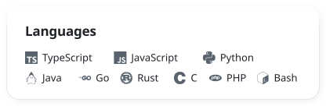</picture>
<picture><source media="(prefers-color-scheme: dark)" srcset="https://raw.githubusercontent.com/onurege3467/onurege3467/main/assets/stack-frontend-dark.svg">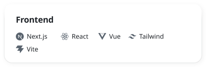</picture>
<picture><source media="(prefers-color-scheme: dark)" srcset="https://raw.githubusercontent.com/onurege3467/onurege3467/main/assets/stack-backend-dark.svg">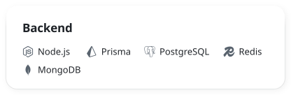</picture>
<picture><source media="(prefers-color-scheme: dark)" srcset="https://raw.githubusercontent.com/onurege3467/onurege3467/main/assets/stack-infrastructure-dark.svg">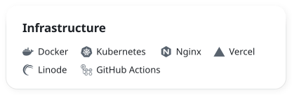</picture>
<picture><source media="(prefers-color-scheme: dark)" srcset="https://raw.githubusercontent.com/onurege3467/onurege3467/main/assets/stack-automation-dark.svg">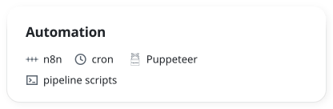</picture>
<picture><source media="(prefers-color-scheme: dark)" srcset="https://raw.githubusercontent.com/onurege3467/onurege3467/main/assets/stack-workflow-dark.svg">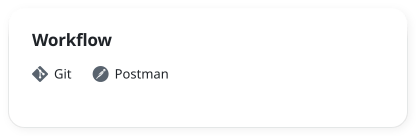</picture>

### Libraries

<a href="https://github.com/onurege3467/webToken"><picture><source media="(prefers-color-scheme: dark)" srcset="https://raw.githubusercontent.com/onurege3467/onurege3467/main/assets/webtoken-dark.svg">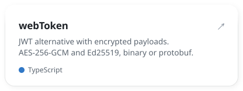</picture></a>
<a href="https://github.com/onurege3467/zero-id"><picture><source media="(prefers-color-scheme: dark)" srcset="https://raw.githubusercontent.com/onurege3467/onurege3467/main/assets/zero-id-dark.svg"></picture></a>
<a href="https://github.com/onurege3467/math"><picture><source media="(prefers-color-scheme: dark)" srcset="https://raw.githubusercontent.com/onurege3467/onurege3467/main/assets/math-dark.svg">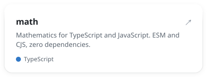</picture></a>
<a href="https://github.com/onurege3467/log"><picture><source media="(prefers-color-scheme: dark)" srcset="https://raw.githubusercontent.com/onurege3467/onurege3467/main/assets/log-dark.svg"></picture></a>
<a href="https://github.com/onurege3467/pg-adapter"><picture><source media="(prefers-color-scheme: dark)" srcset="https://raw.githubusercontent.com/onurege3467/onurege3467/main/assets/pg-adapter-dark.svg"></picture></a>
<a href="https://github.com/onurege3467/zerohelper"><picture><source media="(prefers-color-scheme: dark)" srcset="https://raw.githubusercontent.com/onurege3467/onurege3467/main/assets/zerohelper-dark.svg"></picture></a>
<a href="https://www.npmjs.com/package/pray-time-tr"><picture><source media="(prefers-color-scheme: dark)" srcset="https://raw.githubusercontent.com/onurege3467/onurege3467/main/assets/pray-time-tr-dark.svg">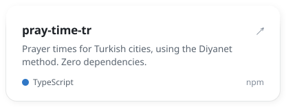</picture></a>
<a href="https://www.npmjs.com/package/sozluk-gov-tr"><picture><source media="(prefers-color-scheme: dark)" srcset="https://raw.githubusercontent.com/onurege3467/onurege3467/main/assets/sozluk-gov-tr-dark.svg">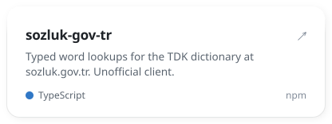</picture></a>
<a href="https://github.com/onurege3467/easycolor"><picture><source media="(prefers-color-scheme: dark)" srcset="https://raw.githubusercontent.com/onurege3467/onurege3467/main/assets/easycolor-dark.svg">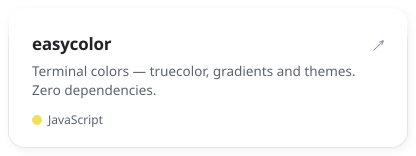</picture></a>
<a href="https://github.com/onurege3467/NQN-Altyapi"><picture><source media="(prefers-color-scheme: dark)" srcset="https://raw.githubusercontent.com/onurege3467/onurege3467/main/assets/nqn-altyapi-dark.svg">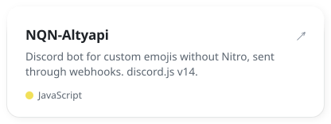</picture></a>

### Contact me

Besides open source, I build closed-source tools and security work for small businesses.

<a href="mailto:info@onurege.click"><picture><source media="(prefers-color-scheme: dark)" srcset="https://raw.githubusercontent.com/onurege3467/onurege3467/main/assets/btn-mail-dark.svg"></picture></a>
<a href="https://onurege.click"><picture><source media="(prefers-color-scheme: dark)" srcset="https://raw.githubusercontent.com/onurege3467/onurege3467/main/assets/btn-globe-dark.svg"></picture></a>

